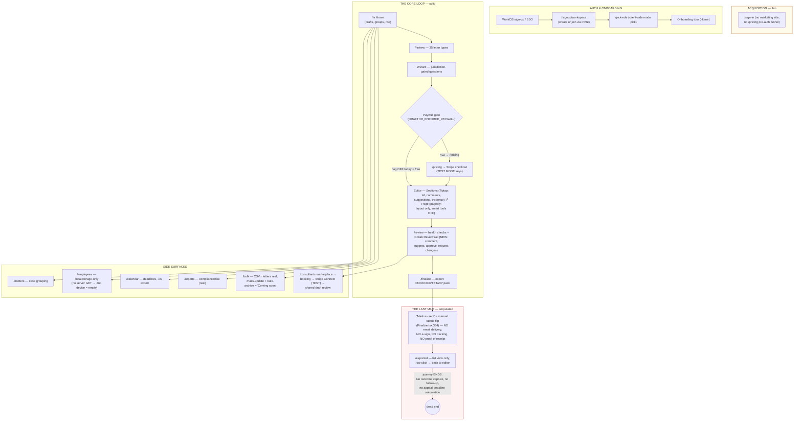
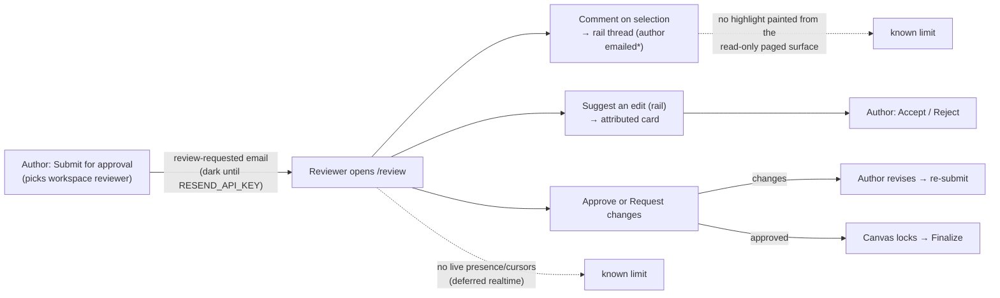
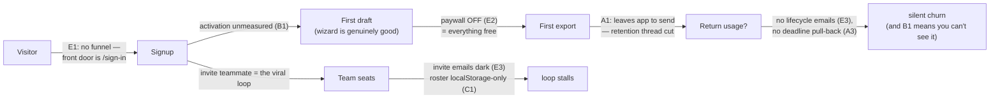

# DraftHR — Flow Map & Gap Register

*2026-07-05. Ground truth traced from code (file refs throughout), not aspiration.
Companion to BUGS_AND_FIXES.md (correctness) and SECURITY.md (enforcement) —
this file is about **product flow**: where the journey works, where it dead-ends,
and what separates today's app from a top-decile revenue machine.*

**The one-line verdict:** DraftHR is a *strong single-player drafting tool with a
paywall bolted on and collaboration newly grafted in* — but the journey still has
one amputated last mile (letters are never actually sent), one blind spot (zero
product telemetry), one architectural ceiling (localStorage-first), and one
unbacked headline claim (unsigned "tribunal-grade" packs). None of these are
bugs; all of them are the difference between a tool and a platform.

---

## 1. The current flow — as it actually runs

### Collaboration flow (shipped this week — Review step)

---

## 2. Seam-by-seam gap register

Every place the journey is **unlinked, manual, dark, or single-player**, with the
$10.7M/wk standard next to it. Severity: 🔴 journey-breaking · 🟠 revenue/retention
drag · 🟡 polish.

### A. The last mile (🔴 the biggest product hole)

| # | Seam | Today | The standard | Where |
|---|---|---|---|---|
| A1 | **Sending the letter** | "Mark as sent" manually flips a status. The user leaves DraftHR, attaches a PDF to Outlook, and we lose the thread. | Send **from** DraftHR: tracked email delivery to the employee (Resend is already integrated!), delivery/open receipt logged to the audit chain, optional registered-post handoff. This is where "tribunal-grade" becomes real: *proof of service*. | `Finalize.tsx:334,445` |
| A2 | **Acknowledgement / e-sign** | Nothing. Offer letters, settlement covers, contract amendments — all need counter-signature; users must go to DocuSign. | Built-in acknowledgement link ("I have received and read") for the 80% case + e-sign integration for the signature case. Every acknowledgement is an audit event. | — (absent) |
| A3 | **Post-send lifecycle** | `/exported` is a list. No outcome tracking (appeal received? grievance escalated? deadline hit?), no automation. | Each sent letter opens a **response window**: appeal-deadline countdown auto-added to Calendar + notification, "log the response" prompt, matter timeline updated. The loop *closes*. | `Exported.tsx:46` |
| A4 | **Evidence-pack signing (X1)** | Crypto fully built (`src/lib/sign/`), never called from export; `manifest.sig` never written. The headline claim is unbacked. | Every pack cryptographically signed + per-file SHA-256 + RFC-3161 timestamp; a public `/verify` page where a tribunal clerk drops the ZIP and sees ✅. That page is also *marketing*. | `pack.ts:81`, BUGS X1 |

### B. Flying blind (🔴 you cannot run a revenue machine without this)

| # | Seam | Today | The standard | Where |
|---|---|---|---|---|
| B1 | **Product analytics** | **Zero.** No PostHog/Amplitude/anything. Funnel conversion, activation rate, feature usage, drop-off points — all unknowable. | Event instrumentation on the ~15 moments that matter (signup, first draft, first export, paywall hit, checkout, review requested, consultant booked). One dashboard: activation %, D7/D30 retention, MRR. | grep-verified absent |
| B2 | **Error observability** | ~81 serverless functions log to stdout only (I-OBS-1). A production 500 is invisible until a user complains. | Sentry envelope on every dispatcher + release tags + alerting. | BUGS I-OBS-1 |
| B3 | **Revenue telemetry** | Stripe events land in DB, but no MRR/churn/conversion view; paywall is env-gated with no experiment surface. | Billing dashboard + webhook-driven metrics; paywall as a config/experiment, not an env var. | `entitlements.ts:115` |

### C. Single-player ceilings (🟠 breaks the "team platform" promise)

| # | Seam | Today | The standard | Where |
|---|---|---|---|---|
| C1 | **Employees roster** | localStorage-only; no server GET → a teammate or 2nd device sees an **empty** roster. The HR-portal vision is built on sand. | `employees` server sync (table exists; handler missing) — the roster is the tenant's, not the browser's. | no `api/store/_handlers/employees.ts` |
| C2 | **Matter participants** | Table exists, no API — participants can't be managed. | Matters as the case spine: participants, tasks, owner. | BUGS scan #13 |
| C3 | **Consultant identity (B6)** | localStorage-only → consultant on a 2nd device is broken. | `userType` server-authoritative from `/api/auth/session`. Small fix, known. | BUGS B6 |
| C4 | **Sync is write-only + poll** | No conflict UI, last-write-wins, no realtime channel (I-SYNC-2/3). Fine solo; risky for teams co-reviewing. | Pull/reconcile with per-draft conflict signal now; realtime channel when co-editing lands. | BUGS I-SYNC-2/3 |
| C5 | **Comments/approvals normalized server record (I-MOAT-2)** | Sync as a JSON blob in `draft_extras`; the `comments`/`approvals` **tables are never written** → no server-authoritative review audit trail. | Review events in real tables, feeding the signed audit chain — "who approved what, when" is evidence. | I-MOAT-2 |

### D. The editor split (🟠 the confusion factory — decided nothing yet)

| # | Seam | Today | The standard | Where |
|---|---|---|---|---|
| D1 | **Two editors, unlabeled jobs** | Sections (Tiptap: ALL smart tools) vs Page (pagedly: layout only, smart tools greyed). Users — including the founder — can't tell which is "real". | Either **Option A** (one on-page editor: comments/AI/suggestions live on the A4 page — the approved north-star mockup) or at minimum **Option B** (rename to "Draft & Review" / "Layout & Print" so the split is intentional). The non-decision is the worst state. | `FEATURES` in `PagedlyDocEditor.tsx:48` |
| D2 | **Review-step comments paint no highlight** | Comment persists but no `<mark>` is written from the read-only paged surface → not click-focusable later. | Write the mark into `section.html` on post (the store owns the HTML; doesn't need the surface to be editable). | verifier note, `CommentsPanel.tsx:95` |
| D3 | **Human suggestions not inline** | Card-mode only in the rail; AI suggestions render inline diffs. | One inline track-changes visual language for both (needs D1's direction first). | `CollabReviewRail.tsx` |

### E. Revenue engine gaps (🟠 the $10.7M/wk delta is mostly here)

| # | Seam | Today | The standard | Where |
|---|---|---|---|---|
| E1 | **No pre-auth funnel** | No marketing page, no public /pricing, no SEO surface; the app IS the front door. | Landing + public pricing + letter-type SEO pages ("redundancy letter template UK") feeding the wizard. Deferred-decision in ROADMAP; mockups exist. | ROADMAP §deferred |
| E2 | **Paywall dark + Stripe in test mode** | Code airtight (0.21.1) but `DRAFTHR_ENFORCE_PAYWALL` unset and `sk_test` keys → **revenue = £0 by configuration**. | Flip: live keys, live webhooks, seed live catalog, enforce. The go-live runbook already exists (`ed4de14`). | env |
| E3 | **Emails dark** | `RESEND_API_KEY` unset → invites, review requests, booking notifications all silently no-op. Collaboration's viral loop (invite → teammate signs up) is severed. | Key set; invite emails become the growth loop; add lifecycle emails (trial ending, draft idle, deadline approaching). | `email.ts:48` |
| E4 | **No referral/expansion loops** | Consultant marketplace exists but no consultant-brings-clients motion; no team-seat expansion prompts; AI credits client-only (B15). | Reviewed-by-consultant badge → consultant referral links; seat-upsell when 2nd reviewer invited; server-side credit ledger. | BUGS B15 |
| E5 | **Bulk ops half-built** | CSV→letters works (killer Business feature); mass-update + bulk-archive are "Coming soon" buttons. | Finish or hide — a disabled button in a paid tier erodes trust. | `BulkOperations.tsx:485-493` |

### F. Trust & scale prerequisites (🟡 before real load)

| # | Seam | Today | Where |
|---|---|---|---|
| F1 | Rate limiter per-warm-instance (Map) | I-HARD-1: Upstash/KV before multi-seat load | `rate-limit.ts` |
| F2 | Webhook dedup + `users.email` unique index | I-HARD-2 | BUGS |
| F3 | DB tier mock-tested only | I-TEST-1: pglite harness | BUGS |
| F4 | Evidence stored as base64 in DB | Blob/S3 (schema `s3Key` ready) | schema `evidence` |
| F5 | Live presence/cursors | Deferred correctly (Liveblocks, Year 2) | ROADMAP |

---

## 3. The money-path, honestly

**Read:** the product converts attention into *drafts* very well; it converts
drafts into *money, retention, and teams* almost not at all — and every one of
those is a config flip or a scoped build, not a rewrite.

---

## 4. What to do — three waves, no fluff

### Wave 1 — "Turn the machine on" (config + small code)
1. **E2** Stripe live keys + live webhook + seed live catalog + `DRAFTHR_ENFORCE_PAYWALL=1` (runbook exists).
2. **E3** `RESEND_API_KEY` → invites/review/booking emails go live.
3. **B1** PostHog (or equivalent): the 15 core events + one funnel dashboard. *(~1 day)*
4. **B2** Sentry envelope on the api dispatchers (I-OBS-1). *(~1 day)*
5. **C3** Consultant identity server-side (B6, small). **E5** hide the two dead bulk buttons.

### Wave 2 — "Close the loop" (the product becomes a platform)
6. **A1** Send-from-DraftHR: tracked email delivery of the letter + audit event. Resend is already there; this is days, not weeks.
7. **A2** Acknowledgement link ("received & read") → audit chain.
8. **A3** Post-send: appeal-deadline auto-countdown + response logging on the matter.
9. **A4** Wire pack signing (X1) + public verify page — the moat, and the runbook item with the highest talk-to-build ratio.
10. **C1/C2** Employees + matter-participants server sync — unblocks the HR-portal wave.
11. **D2** Paint comment marks from the Review step (store-side write).

### Wave 3 — "Pick the editor future" (the strategic call)
12. **D1** Decide A vs B. If A (the approved mockup): port comments → suggestions → AI into pagedly in that order, behind a flag, with the guard tests extended. If not yet: ship B's renames in a day and stop paying the confusion tax.
13. **C4** Pull/reconcile sync layer (prereq for any real-time future).
14. **E1** Landing + public pricing + 3 SEO letter pages as the top of funnel.

---

## 5. What was verified vs assumed

- **Verified in code this session:** every file:line above; the collab chain
  end-to-end (one break found & fixed: `data-section-anchor` emission); zero
  analytics; no send path; employees handler absent; paywall/email env-gating.
- **Verified live on prod:** unauth security gates, notify endpoint, review rail
  deploy.
- **Assumed (needs your data):** anything about actual user behaviour — because
  of B1, no one can know it yet. That's the point of Wave 1 item 3.
